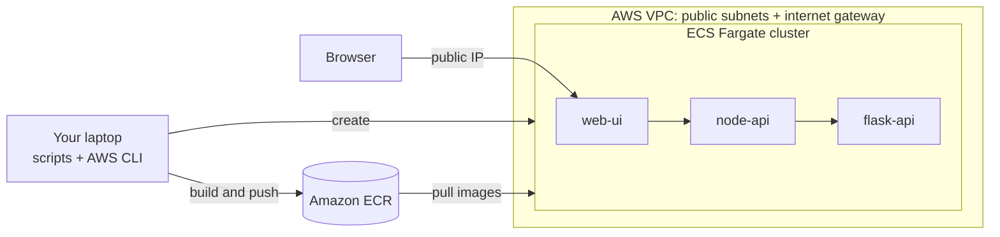

# Express Reliability Platform V3: Manual AWS Deployment

## Version Purpose

Version 3 takes the same three-service platform from V2 and deploys it to AWS manually. This version
teaches the cloud building blocks before Terraform automates them in V4.

## Goal

Create ECR repositories, build and push the three service images, deploy them on ECS Fargate, expose
them through AWS networking, validate from public endpoints, and clean up all resources.

## High-Level Architecture

The same three services now run on AWS, deployed by hand with scripts. There is no load balancer yet:
you reach the web UI through its task's public IP.



---

## Project Structure

```text
express-reliability-platform-v03/
├── apps/
│   ├── flask-api/
│   ├── node-api/
│   └── web-ui/
├── docker-compose.yml
├── scripts/
│   ├── create_ecr_repos.sh
│   ├── build_tag_push_ecr.sh
│   ├── deploy_ecs.sh
│   ├── get_public_ips.sh
│   └── cleanup_v4.sh
└── README.md
```

## Prerequisites

Before running this version, confirm:

- [ ] **Node.js 18+** installed.
- [ ] **Docker Desktop is running** — verify: `docker ps`.
- [ ] **Docker Compose v2** available.
- [ ] **AWS CLI v2 configured** with credentials that can use ECR and ECS — verify: `aws sts get-caller-identity`.
- [ ] **Make the helper scripts executable** (one time):
  ```sh
  chmod +x scripts/*.sh
  ```

## Run Steps

Validate locally first:

```sh
docker compose up --build -d
docker compose ps
docker compose down
```

Deploy manually to AWS:

```sh
aws sts get-caller-identity
./scripts/create_ecr_repos.sh
./scripts/build_tag_push_ecr.sh
./scripts/deploy_ecs.sh
./scripts/get_public_ips.sh
```

Clean up:

```sh
./scripts/cleanup_v4.sh
```

## Validation Checklist

- [ ] ECR repositories exist for all three services.
- [ ] Images are pushed with the expected tags.
- [ ] ECS services reach desired running count.
- [ ] Public endpoints respond.
- [ ] Cleanup removes ECS, ECR, networking, and IAM resources created by the version.
