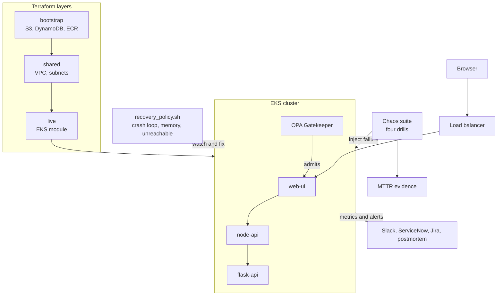

# Express Reliability Platform V9: Self-Healing Platform

## Purpose

V9 builds on V8's governance and complete incident pipeline, then adds self-healing recovery scripts, a recovery policy loop, and a repeatable chaos suite that records MTTR evidence. V10 builds on this version by adding a second cloud.

## What You Will Demonstrate

- A three-service AWS EKS platform with monitoring, alerting, and governance.
- Automated Slack, ServiceNow, Jira, and postmortem incident workflows.
- Recovery for crash loops, memory pressure, and unreachable services.
- Four controlled chaos drills with recorded recovery evidence.

## High-Level Architecture

V9 closes the loop: failures are injected on purpose, detected, and fixed automatically, and the recovery
time is recorded as evidence. The cluster is built in Terraform layers and the apps are installed with Helm.



---

## Project Structure

```text
express-reliability-platform-v09/
├── apps/                         # Flask API, Node API, and web UI
├── platform/                     # Helm charts and Terraform layers
├── governance/                   # Gatekeeper policies and namespaces
├── monitoring/                   # Prometheus, Grafana, and Alertmanager
├── incident/                     # Slack, ServiceNow, Jira, postmortem helpers
├── chaos/                        # four controlled resilience drills
├── automation/                   # recovery scripts and recovery policy loop
├── scripts/                      # deploy, image build, cleanup, chaos suite
└── docs/                         # portfolio and deployment guide
```

## Run the Platform

```sh
cd express-reliability-platform-v09
chmod +x automation/*.sh chaos/*.sh incident/*.sh scripts/*.sh

# Configure integrations when you are ready to use them.
export SLACK_WEBHOOK_URL="YOUR_URL"
export SN_INSTANCE="devXXXXXX"
export SN_USER="admin"
export SN_PASS="YOUR_PASSWORD"
export JIRA_DOMAIN="your-domain.atlassian.net"
export JIRA_EMAIL="you@example.com"
export JIRA_API_TOKEN="YOUR_TOKEN"

./scripts/deploy_platform.sh
```

Start auto-recovery in one terminal and run the chaos suite in another:

```sh
INTERVAL_SECONDS=30 ./automation/recovery_policy.sh
./scripts/chaos_suite.sh
```

## Validation Checklist

- [ ] The three services are healthy on EKS.
- [ ] Prometheus, Grafana, and Alertmanager are collecting and routing alerts.
- [ ] Slack, ServiceNow, and Jira integrations work or produce valid dry-run payloads.
- [ ] All four chaos drills complete and capture evidence.
- [ ] Each automated recovery path runs successfully.
- [ ] MTTR evidence is ready for the portfolio documentation.
