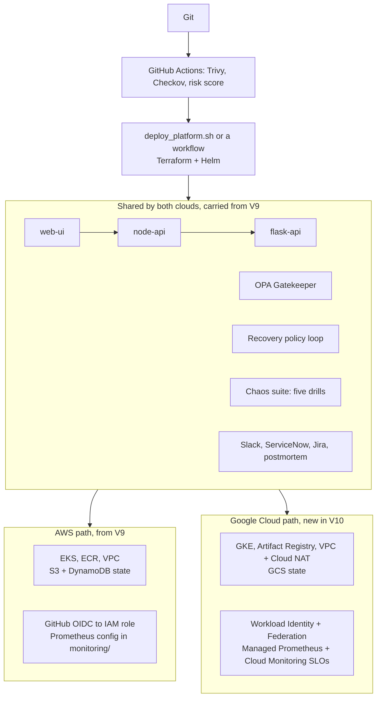

# Express Reliability Platform V10: Multi-Cloud (AWS + Google Cloud)

## Purpose

V10 builds on V9. Everything V9 runs on AWS EKS is still here, and V10 adds Google Cloud beside it. You choose the cloud with one setting:

```sh
CLOUD=aws ./scripts/deploy_platform.sh   # the V9 platform on EKS
CLOUD=gcp ./scripts/deploy_platform.sh   # the same platform on GKE
```

The point is portability. The apps, Helm charts, chaos drills, incident pipeline, and governance are shared by both clouds. Only the cloud layer differs.

V10 adds three things to V9:

- **A second cloud**: GKE, Artifact Registry, and Workload Identity beside EKS, ECR, and IAM
- **SLOs as code in Cloud Monitoring** (GCP), with multi-window burn-rate alerts
- **Chaos Drill 5: Error-Budget Burn** (both clouds), which fails requests on purpose so you can watch the error rate climb, then measures recovery

## High-Level Architecture

Everything above the cloud line is shared. Below it, you deploy to AWS, Google Cloud, or both.



---

## What You Will Demonstrate

- Everything from V9 on **EKS**: three services, governance, the incident pipeline, self-healing, and chaos evidence
- The same platform on **GKE** (Standard or Autopilot), built with layered Terraform
- Private nodes on a VPC-native network, with Cloud NAT for outbound traffic
- **Workload Identity** for pods and **Workload Identity Federation** for GitHub Actions: no service-account keys anywhere
- **Google Managed Prometheus** scraping the apps' existing `/metrics` endpoints
- Availability and latency **SLOs** with fast-burn (page) and slow-burn (ticket) alerts
- Five chaos drills with recovery-time evidence

## The Two Clouds Side by Side

| Concern | AWS path (from V9) | Google Cloud path (new in V10) |
|---|---|---|
| Kubernetes | EKS + managed node group | GKE Standard node pool, or Autopilot |
| Images | ECR | Artifact Registry (cleanup policy keeps the last 15) |
| Terraform state | S3 bucket + DynamoDB lock | GCS bucket (versioned, locks built in) |
| Network | VPC, public/private subnets, IGW | Global VPC, regional subnet with pod/service ranges, Cloud NAT |
| Pod permissions | IRSA (IAM roles for service accounts) | Workload Identity (KSA → Google service account) |
| CI/CD identity | GitHub OIDC → IAM role | GitHub OIDC → Workload Identity Federation |
| Metrics | Self-run Prometheus | Google Managed Prometheus (`PodMonitoring`, `Rules`) |
| SLOs | Prometheus alert rules | Cloud Monitoring SLOs + burn-rate alert policies |
| Load balancer | ELB (hostname) | GCP external load balancer (IP) |
| Cost guardrail | AWS Budgets | Cloud Billing budget (50% / 90% / 100%) |

**Carried over from V9 and shared by both clouds:** `apps/` (plus the fixes below), `platform/helm/` (plus the service account and SHA tags), `governance/`, `incident/`, `automation/`, `monitoring/`, and `chaos/` (plus Drill 5).

**Left out on purpose:** V9's older `terraform/` folder and the `*_v9.sh` scripts that use it. `deploy_platform.sh` and `platform/terraform/` replace them.

## Project Structure

```text
express-reliability-platform-v10/
├── apps/                          # flask-api, node-api, web-ui
├── platform/
│   ├── helm/                      # shared charts; service account + SHA image tags
│   └── terraform/
│       ├── aws/                   # from V9: bootstrap, shared, live, modules/eks
│       └── gcp/
│           ├── bootstrap/         # APIs, GCS state, Artifact Registry, CI identity, budget
│           ├── shared/            # VPC, subnet + secondary ranges, Cloud NAT
│           ├── modules/gke/       # GKE cluster, node pool, Workload Identity
│           └── live/              # calls the module + slo.tf (SLOs and burn-rate alerts)
├── monitoring/                    # Prometheus, Grafana, Alertmanager config from V9
│   └── gmp/                       # PodMonitoring + alert Rules for Managed Prometheus
├── governance/  incident/  automation/
├── chaos/                         # five drills (error_budget_burn.sh is new)
├── scripts/                       # deploy_platform, cleanup_platform (CLOUD=aws|gcp), and per-cloud scripts
└── .github/workflows/             # deploy-aws.yml and deploy-gcp.yml, both keyless
```

## Prerequisites

For either cloud: `terraform` ≥ 1.5, `kubectl`, `helm`, and `docker` with buildx.

**AWS:** an account and the `aws` CLI, signed in. Run V9's `./scripts/cleanup_platform.sh` first: V10 reuses the same ECR repository and cluster names.

**Google Cloud:** a project with billing enabled, plus `gcloud` with `gke-gcloud-auth-plugin`. New accounts usually get trial credit. Sign in once:

```sh
gcloud auth login
gcloud auth application-default login
```

## Run It

**On AWS:**

```sh
cd express-reliability-platform-v10
CLOUD=aws ./scripts/deploy_platform.sh
```

The script runs bootstrap → images → shared → live (EKS) → namespace and service account → Helm → Gatekeeper → monitoring. As in V9, the monitoring step reports that `monitoring/` must be applied through your own Prometheus/Grafana stack.

**On Google Cloud:**

```sh
cd express-reliability-platform-v10
export PROJECT_ID="your-project-id"
export ALERT_EMAIL="you@example.com"   # optional: where burn-rate alerts go
export AUTOPILOT=false                  # true = GKE Autopilot

CLOUD=gcp ./scripts/deploy_platform.sh
```

The script runs bootstrap → images → shared → live (cluster + SLOs) → Workload Identity → Helm → Gatekeeper → Managed Prometheus.

**On both:** each deploy switches your `kubectl` context. Check `kubectl config current-context` before running a drill, so it hits the cluster you mean.

Then start self-healing in one terminal and run the chaos suite in another:

```sh
INTERVAL=30 ./automation/recovery_policy.sh
./scripts/chaos_suite.sh
```

To test the error-budget drill on its own:

```sh
ERROR_RATE=0.2 DURATION=300 ./chaos/error_budget_burn.sh
```

On Google Cloud, open **Cloud Monitoring → Services → erp-flask-api**. You will see the error budget drop and the fast-burn alert fire. On AWS, watch `flask_api_requests_total{status="503"}` in Prometheus.

## SLOs (Google Cloud)

| SLO | Target | Window | Alerts |
|---|---|---|---|
| Availability: requests that do not return 5xx | 99.5% | 28 days | Page at 14.4× burn over 1h; ticket at 6× over 6h |
| Latency: `/score` responses under 500 ms | 95% | 28 days | Warn at 14.4× burn over 1h |

**Why 99.5%?** The 28-day error budget is 0.5%, about 3.4 hours of full outage. That is tight enough to matter for a customer-facing API and loose enough to ship weekly. A 14.4× burn means about 2% of the monthly budget is gone in one hour, so it pages. A 6× burn over 6 hours is a slow leak, so it opens a ticket. This is the multi-window approach from the Google SRE Workbook.

## Keyless CI/CD (optional)

Copy the workflow for the cloud you use to the repository root's `.github/workflows/`. Each one deploys on every push to `main`, so copy both only if you want both clouds running.

**AWS (`deploy-aws.yml`):** run `CLOUD=aws ./scripts/deploy_platform.sh` once so the bootstrap layer exists, then add an `AWS_ROLE_ARN` secret for an IAM role that trusts your repository through GitHub OIDC.

**Google Cloud (`deploy-gcp.yml`):**

1. Re-run bootstrap with your repo:

   ```sh
   terraform -chdir=platform/terraform/gcp/bootstrap apply \
     -var project_id=$PROJECT_ID -var github_repo=<owner>/<repo>
   ```

2. Add four repository secrets from `terraform -chdir=platform/terraform/gcp/bootstrap output`:
   - `GCP_PROJECT_ID`
   - `GCP_WORKLOAD_IDENTITY_PROVIDER`
   - `GCP_SERVICE_ACCOUNT`
   - `GCP_STATE_BUCKET`

Both pipelines run: Trivy + Checkov → Terraform → risk score → build/push (tagged with the commit SHA) → Helm → pod-kill chaos drill.

## Fixes to V9 That Apply on Both Clouds

- **flask-api** now counts every request with its real status code. V9 only counted successes, so a 5xx SLO could never see a failure. Health checks and scrapes are excluded so they do not inflate the SLO.
- **Images are tagged with the git SHA**, not `:latest`. Gatekeeper's `no-latest-tag` policy would otherwise block replacement pods during chaos drills.
- **node-api** gets `FLASK_BASE_URL` from Helm, so it reaches flask-api through its Service.
- **`risk_score.sh`** reads the load balancer IP or hostname, because GKE exposes an IP and EKS a hostname.

## Cost Control

Run cleanup at the end of every session:

```sh
CLOUD=aws ./scripts/cleanup_platform.sh
CLOUD=gcp ./scripts/cleanup_platform.sh
```

- **AWS:** you pay for the EKS control plane, nodes, and load balancer while they run.
- **Google Cloud:** a zonal Standard cluster (the default) or one Autopilot cluster per billing account falls under GKE's free cluster-management tier. You pay for nodes or pods, the load balancer, and NAT while it runs. Set `billing_account` in bootstrap to get budget alerts.

## Autopilot Notes

- With `AUTOPILOT=true`, Google manages nodes. The node-drain drill skips itself, and the script skips open-source Gatekeeper (use GKE Policy Controller).
- Managed Prometheus and Workload Identity are on by default.

## Validation Checklist

- [ ] `terraform validate` passes in `bootstrap`, `shared`, and `live` for each cloud you use
- [ ] AWS: all three services are healthy on EKS and the web UI answers on the load balancer hostname
- [ ] Google Cloud: all three services are healthy on GKE and the web UI answers on the load balancer IP
- [ ] Pods run as `platform-workload` (on GKE, with the `iam.gke.io/gcp-service-account` annotation)
- [ ] Google Cloud: Managed Prometheus shows `flask_api_requests_total` in Metrics Explorer
- [ ] Google Cloud: both SLOs appear under Cloud Monitoring → Services
- [ ] Drill 5 recovers within SLO (on Google Cloud, it also fires the fast-burn alert)
- [ ] Chaos suite results and recovery times recorded in `docs/README.md`
- [ ] `cleanup_platform.sh` leaves no cluster, NAT, or load balancer running on either cloud

## Results (fill in after your run)

| Drill | Failure injected | Recovery time | SLO | Result |
|---|---|---|---|---|
| 1 | Pod kill (flask-api) | [X]s | 60s | |
| 2 | Node drain (Standard only) | [X]s | 120s | |
| 3 | CPU pressure (HPA) | [X]s | 90s | |
| 4 | Crash loop | [X]s | 60s | |
| 5 | Error-budget burn (20% 5xx) | [X]s | 90s | |

Only publish numbers from your own runs.
